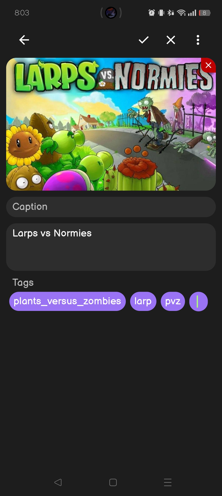

# MemeHive

**English** | [Русский](README.ru.md)

MemeHive is an Android app for keeping your memes organized and finding the right image when you need it. Save images with captions, descriptions, and tags, group them into collections, and copy them into other apps.

## Features

- Import images from your device or send an image to MemeHive from another app.
- Organize media into collections with custom covers.
- Search tags, captions, and descriptions, with support for some typing mistakes.
- Select multiple items to add them to a collection, duplicate them, or delete them.
- Export and import collections as `.mhc` files.
- Open a quick image picker from a notification and copy an image to the clipboard.
- English and Russian interface text.

MemeHive stores its library on the device. It has no account system or built-in cloud synchronization. Android system backup is enabled; see the [user guide](docs/user-guide.md#storage-and-backups) for the distinction between backup and collection export.

  
  &nbsp;&nbsp;&nbsp;&nbsp;
  

## Get started

MemeHive requires **Android 10 (API 29) or later**.

1. Open [GitHub Releases](https://github.com/FARYWAVE/MemeHive/releases) and download the `.apk` file attached to the release. The source-code archives are for developers.
2. Open the APK on your Android device and follow the installation prompts. If Android asks, allow installation from the browser or file manager you used.
3. Open MemeHive, choose **+ → New media**, select an image, add useful tags, and save with the checkmark.

To build the app yourself, see [Development](docs/development.md#setup).

## Documentation

| Guide | What you will find |
| --- | --- |
| [User guide](docs/user-guide.md) | Everyday workflows, collection transfers, and troubleshooting |
| [Development](docs/development.md) | Setup, builds, tests, and contributing changes |
| [Architecture](docs/architecture.md) | Components, data flow, storage, search, and implementation tradeoffs |

