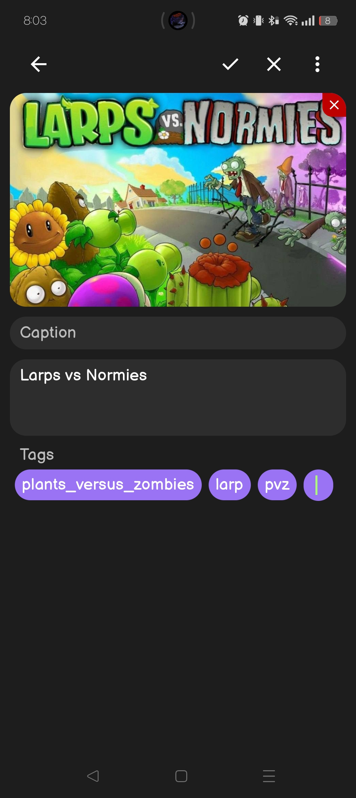

# MemeHive

[English](README.md) | **Русский**

MemeHive — Android-приложение, которое помогает хранить мемы в порядке и быстро находить нужное изображение. Добавляйте подписи, описания и теги, объединяйте мемы в коллекции и копируйте их в другие приложения.

## Возможности

- Импорт изображений с устройства или отправка изображения в MemeHive из другого приложения.
- Коллекции с собственными обложками.
- Поиск по тегам, подписям и описаниям с поддержкой некоторых опечаток.
- Групповые действия: добавление в коллекцию, дублирование и удаление.
- Экспорт и импорт коллекций в формате `.mhc`.
- Быстрый выбор изображения из уведомления с копированием в буфер обмена.
- Интерфейс на русском и английском языках.

Библиотека хранится на устройстве. В приложении нет учётных записей и встроенной облачной синхронизации. Системное резервное копирование Android включено; о его отличиях от экспорта коллекций читайте в [руководстве пользователя](docs/user-guide.ru.md#хранение-и-резервные-копии).

  
  &nbsp;&nbsp;&nbsp;&nbsp;
  

## Установка и начало работы

Требуется **Android 10 (API 29) или новее**.

1. Откройте [GitHub Releases](https://github.com/FARYWAVE/MemeHive/releases) и скачайте файл `.apk`, прикреплённый к выпуску. Архивы исходного кода предназначены для разработчиков.
2. Откройте APK на Android-устройстве и следуйте инструкциям установки. Если Android запросит разрешение, разрешите установку из браузера или файлового менеджера, которым вы воспользовались.
3. Откройте MemeHive, выберите **+ → Добавить медиа**, укажите изображение, добавьте теги и нажмите галочку для сохранения.

Для самостоятельной сборки см. [руководство по разработке](docs/development.ru.md#подготовка).

## Документация

| Руководство | Содержание |
| --- | --- |
| [Руководство пользователя](docs/user-guide.ru.md) | Основные действия, перенос коллекций и решение проблем |
| [Разработка](docs/development.ru.md) | Настройка окружения, сборка, тесты и внесение изменений |
| [Архитектура](docs/architecture.ru.md) | Компоненты, потоки данных, хранение, поиск и архитектурные решения |
