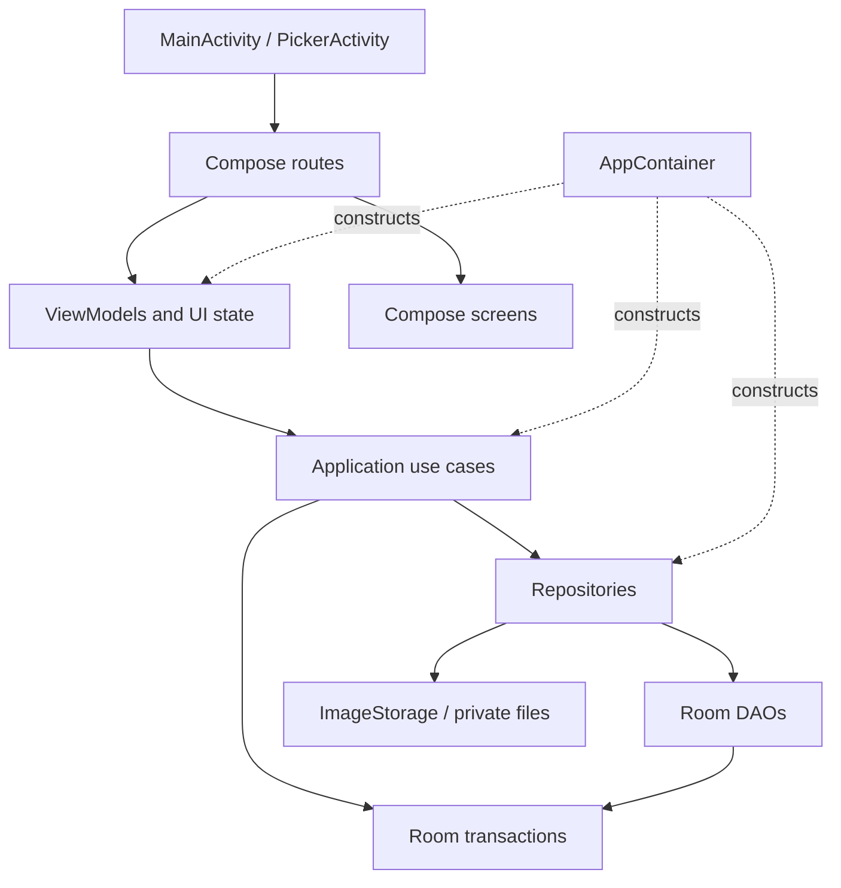

# MemeHive architecture

**English** | [Русский](architecture.ru.md)

[Back to README](../README.md) · [Development](development.md)

MemeHive separates UI, business operations, and local data access. Use cases provide the entry point for business logic and coordinate independent repositories.

## Structure and dependencies

MemeHive is a single-module Android app. Packages separate UI, application operations, models, and persistence, but Gradle does not enforce separate module boundaries.

All Kotlin paths below are relative to [`app/src/main/java/com/farywave/memehive/`](../app/src/main/java/com/farywave/memehive).

| Package or entry point | Responsibility |
| --- | --- |
| `MemeHiveApplication` | Application-scoped container, Coil image loader, notification channel |
| `AppContainer` | Constructs the database, repositories, use cases, and ViewModel factories |
| `ui/activity/main` | Main library, editor, dialogs, and Android image-intent handling |
| `ui/activity/picker` | Notification-launched image picker and clipboard handoff |
| `ui/component`, `ui/theme` | Shared controls, feedback, and visual styling |
| `ui/navigation` | Navigation between the library and media editor |
| `ui/model`, `ui/mapper` | Editable drafts, message state, collection filtering, and UI mappings |
| `application/usecase` | Media and collection operations, search, deletion, and collection transfer |
| `domain/model` | Media, image, and collection models |
| `data/local/db` | Room entities, DAOs, relations, repositories, mappings, and migrations |
| `data/local/storage` | Image copying, path resolution, dimensions, and file cleanup |
| `core/collection_transfer` | Archive format, transfer models, validation, and mappings |

Dependency injection is manual. `MemeHiveApplication` lazily owns `AppContainer`, whose factory supplies ViewModels and saved-state handles. Dispatchers are constructor dependencies where needed: file work uses IO and search uses the computation dispatcher.

This is layered code, not a strict framework-independent domain architecture: use cases directly depend on Room and concrete repositories, and the `Image` model contains an Android `Uri`. The arrangement makes wiring explicit, while persistence and Android behavior remain coupled to application operations.

## Dependency rules and rationale

Two deliberate rules govern access to business logic and persistence:

1. **Repositories do not depend on other repositories.** Each repository handles its own data access responsibilities. Operations that need several repositories are coordinated by use cases.
2. **The UI accesses repositories only through use cases.** This applies to reads as well as writes, including ViewModels and activities. Use cases are the consistent entry point for business operations; UI code must not bypass them to call a repository directly.

These rules are intended to prevent circular dependencies and remove ambiguity about where UI code should access business logic. When adding a feature, follow `UI → use case → repositories`. If an operation spans media, tags, and collections, coordinate those repositories in the use-case layer instead of making repositories call one another.

`AppContainer` is responsible for assembling dependencies. For image mapping, it passes `imageRepository::toModel` as a function to the media and collection repositories. Those repositories depend on a mapping function rather than another repository's type; this is still an indirect connection to the image repository's implementation. Keep that distinction in mind when changing the wiring, and keep cross-repository business operations in use cases.

These are code organization conventions in the current single-module project, rather than boundaries enforced by separate Gradle modules.

## UI state and Android integration

Routes obtain ViewModels, collect flows with lifecycle awareness, register file-picker launchers, and connect screen events to operations. Screens render supplied state and callbacks. ViewModels own searches, selection, drafts, loading state, and mutation results.

The media editor and collection editor use `SavedStateHandle` to retain draft state across recreation. Media drafts are separate from persisted models, allowing unsaved-change detection and explicit save/discard behavior. Feedback is delivered through UI message state and `AppFeedback`.

`MainActivity` accepts single-image `SEND`, `VIEW`, and `EDIT` intents and opens the editor. The quick picker uses a separate, non-exported `PickerActivity`, opened through a notification's `PendingIntent`. Selecting an image resolves a `FileProvider` content URI, writes it to the clipboard, and closes the picker. The provider exposes only `files/images/`.

The manifest declares notification permission and no internet permission. There is no remote backend or synchronization layer in the current implementation. Android system backup is enabled through the manifest and backup XML resources.

## Persistent data model

Room stores metadata in `memehive_db`, currently at schema version **5**. Image bytes live separately under the application's private `files/images/` directory.

| Table | Role |
| --- | --- |
| `media_items` | Caption, description, and optional image reference |
| `images` | Unique stored filename and SHA-256 hash, plus optional width and height |
| `tags` | Tag records |
| `media_item_tags` | Many-to-many relationship between items and tags |
| `collections` | Collection name and optional cover image reference |
| `collection_entries` | Many-to-many relationship between collections and items |

An image may be referenced by several media items and collection covers. Collection membership does not imply ownership of an image or item. Junction rows cascade when their parent records are deleted; image references use `SET_NULL` if the referenced image row is deleted.

DAOs provide reads and writes; repositories map database entities and relations to application models. Room flows make changes observable to the library and picker. Schema snapshots live in [`app/schemas`](../app/schemas), with explicit migrations registered in `MemeHiveDatabase`.

## Saving and deleting images

A typical media save goes through `EditingViewModel` → `MediaItemUseCases` → repositories:

1. Copy the selected image into private storage and track the created file.
2. Hash its contents with SHA-256. Reuse an existing image row for identical contents, or insert a new row with its filename and dimensions.
3. Save the media record, tags, and collection memberships inside a Room transaction.
4. Clean up newly created files that are not referenced by committed image records.

`ImageChanges` tracks created files and performs cleanup even when an operation throws or is cancelled. Image replacement and deletion use `withImageCleanup`: unreferenced image rows are removed inside the database operation, and their files are deleted after successful completion. An image still used by another item or cover is retained.

SQLite transactions cannot roll back filesystem operations. This implementation coordinates them through tracking and deferred cleanup; it is not a crash-proof transaction spanning both systems. Cleanup errors are logged and may leave unused files behind.

Deleting an item removes its memberships and orphaned tags. Deleting a collection preserves its items unless `deleteContents` is requested; even then, only items exclusive to that collection are deleted. Batch image import and batch duplication process items individually, so a later failure can leave earlier successful items in place.

## Search

`MediaSearchUseCase` observes the library and builds an in-memory search representation. It normalizes text with Unicode NFKC, lowercase conversion, and whitespace normalization. Matching is ranked as follows:

1. Exact tag.
2. Tag prefix.
3. Tag substring.
4. Caption substring.
5. Description substring.
6. Fuzzy word match when the query is a single alphanumeric string of at least four characters.

Fuzzy matching permits a single insertion, deletion, substitution, or adjacent transposition. Fuzzy scores favor tags over captions and descriptions; item IDs provide a stable final tie-breaker. Multiword queries use substring matching rather than independent token matching. There is no OCR or semantic image search.

The library debounces query changes by 200 ms. Search runs on the computation dispatcher and cancels superseded work. `CollectionSearchFilter` combines ranked results with reactive memberships, preserving ranking while restricting the chosen collection. Loading and failure states retain prior search results, and retries restart observation.

The in-memory approach supports custom ranking without a database search index. Its cost grows with library size: database changes rebuild the search representation, and queries scan the items.

## Collection transfer

A `.mhc` file is a ZIP archive with MIME type `application/vnd.memehive.collection`. It contains:

- `manifest.json`: exporting app version code, timestamp, collection name/cover path, and item metadata.
- `collection/`: the cover image, if present.
- `media/`: exported item images, referenced by relative paths in the manifest.

The format includes captions, descriptions, and tags. It does not preserve database IDs or memberships in other collections. The manifest records `appVersion`, but there is no separate archive-schema version or version-negotiation mechanism.

`CollectionTransferUseCases` stages transfer files in temporary cache directories. Export copies images, writes the manifest, then writes the ZIP to the URI selected through Android's document picker. A failed write to that external destination can leave an incomplete output file; success is reported only after completion.

Import checks the `.mhc` filename, extracts and validates the archive, then creates a new collection and new items in a Room transaction using shared image-change tracking. It does not merge records by name or ID. Identical image contents can still reuse an existing image record. Temporary transfer directories are cleaned up afterward.

`CollectionArchiveReader` rejects paths escaping the extraction directory, duplicate destinations, malformed manifests, and missing or empty referenced files. Default extraction limits are 512 MiB total, 32 MiB per file, 2 MiB for the manifest, and 10,000 archive entries. These are import limits; export does not enforce the same size limits in advance.

## Change boundaries

- **New user workflow:** screen callbacks and ViewModel state, with a use case for coordinated persistence.
- **Storage change:** repositories/storage helpers, cleanup behavior, and persistence tests.
- **Schema change:** entities, registered migrations, exported schemas, and migration tests.
- **Search change:** ranking/normalization logic and search tests; verify behavior in both library and picker.
- **Transfer change:** transfer models, reader/writer, malformed-archive tests, and round-trip instrumentation tests.

See [Development](development.md#checks) for the existing verification commands.
