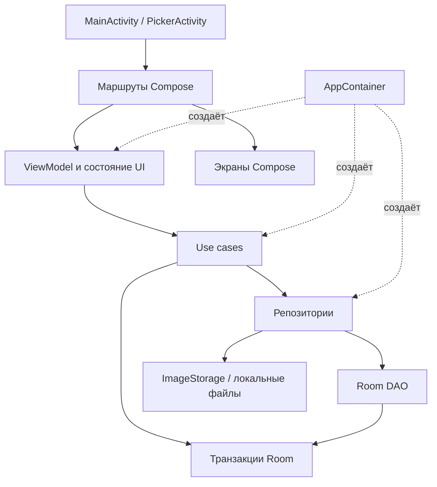

# Архитектура MemeHive

[English](architecture.md) | **Русский**

[К README](../README.ru.md) · [Разработка](development.ru.md)

MemeHive разделяет интерфейс, бизнес-операции и доступ к локальным данным. Use cases служат точкой входа в бизнес-логику и координируют независимые репозитории.

## Структура и зависимости

MemeHive — Android-приложение с одним модулем. Интерфейс, операции приложения, модели и хранение разделены по пакетам, но Gradle не обеспечивает границы между ними как между отдельными модулями.

Пути к Kotlin-коду ниже указаны относительно [`app/src/main/java/com/farywave/memehive/`](../app/src/main/java/com/farywave/memehive).

| Пакет или точка входа | Ответственность |
| --- | --- |
| `MemeHiveApplication` | Контейнер зависимостей уровня приложения, загрузчик Coil, канал уведомлений |
| `AppContainer` | Создание базы данных, репозиториев, use cases и фабрик ViewModel |
| `ui/activity/main` | Библиотека, редактор, диалоги и обработка Android intent с изображениями |
| `ui/activity/picker` | Быстрый выбор из уведомления и копирование в буфер обмена |
| `ui/component`, `ui/theme` | Общие элементы интерфейса, сообщения и оформление |
| `ui/navigation` | Навигация между библиотекой и редактором |
| `ui/model`, `ui/mapper` | Черновики, состояние сообщений, фильтрация коллекций и преобразования моделей UI |
| `application/usecase` | Операции с медиа и коллекциями, поиск, удаление, импорт и экспорт |
| `domain/model` | Модели медиа, изображений и коллекций |
| `data/local/db` | Сущности Room, DAO, связи, репозитории, преобразования и миграции |
| `data/local/storage` | Копирование изображений, разрешение путей, размеры и очистка файлов |
| `core/collection_transfer` | Формат архива, модели переноса, проверка и преобразования |

Зависимости передаются вручную. `MemeHiveApplication` лениво создаёт `AppContainer`; его фабрика предоставляет ViewModel и объекты сохранённого состояния. Диспетчеры при необходимости передаются через конструкторы: IO используется для файлов, вычислительный диспетчер — для поиска.

Use cases напрямую зависят от Room и конкретных репозиториев, а модель `Image` содержит Android `Uri`. Такая организация делает сборку зависимостей явной, но операции приложения остаются связаны с Android и механизмом хранения.

## Правила зависимостей и их назначение

Доступ к бизнес-логике и данным подчиняется двум намеренно выбранным правилам:

1. **Репозитории не зависят от других репозиториев.** Каждый отвечает за свою часть доступа к данным. Операции, которым нужны несколько репозиториев, координируются в use cases.
2. **UI обращается к репозиториям только через use cases.** Это относится к чтению и записи, включая ViewModel и activity. Use cases — единая точка входа для бизнес-операций; UI не должен обходить их и обращаться к репозиторию напрямую.

Эти правила нужны для предотвращения циклических зависимостей и неоднозначности в том, как UI должен обращаться к бизнес-логике. При добавлении функции соблюдайте направление `UI → use case → репозитории`. Если операция затрагивает медиа, теги и коллекции, координируйте их репозитории в слое use cases.

За сборку зависимостей отвечает `AppContainer`. Для преобразования изображений он передаёт функцию `imageRepository::toModel` в репозитории медиа и коллекций. Они зависят от функции преобразования, а не от типа другого репозитория, хотя косвенная связь с реализацией репозитория изображений сохраняется. Учитывайте это при изменении связей и оставляйте бизнес-операции с несколькими репозиториями в use cases.

В одномодульном проекте эти правила поддерживаются организацией кода, а не границами Gradle-модулей.

## Состояние UI и интеграция с Android

Маршруты получают ViewModel, собирают потоки с учётом жизненного цикла, регистрируют запуск системных окон выбора файлов и связывают события экрана с операциями. Экраны отображают переданное состояние и вызывают обработчики. ViewModel управляют поиском, выбором элементов, черновиками, загрузкой и результатами изменений.

Редакторы медиа и коллекций используют `SavedStateHandle` для восстановления черновиков при пересоздании. Черновики медиа отделены от сохранённых моделей, что позволяет обнаруживать несохранённые изменения и явно сохранять или отменять их. Сообщения пользователю передаются через состояние UI и `AppFeedback`.

`MainActivity` принимает `SEND`, `VIEW` и `EDIT` intent для одного изображения и открывает редактор. Быстрый выбор использует отдельную неэкспортируемую `PickerActivity`, которую открывает `PendingIntent` уведомления. При выборе изображения приложение получает content URI через `FileProvider`, записывает его в буфер обмена и закрывает окно. Провайдер предоставляет доступ только к `files/images/`.

В манифесте объявлено разрешение на уведомления; разрешения на интернет нет. Удалённого сервера и слоя синхронизации в приложении нет. Системное резервное копирование Android включено через манифест и XML-ресурсы.

## Модель хранения данных

Room хранит метаданные в `memehive_db`; текущая версия схемы — **5**. Сами изображения находятся отдельно, в закрытом каталоге приложения `files/images/`.

| Таблица | Назначение |
| --- | --- |
| `media_items` | Подпись, описание и необязательная ссылка на изображение |
| `images` | Уникальные имя файла и SHA-256, необязательные ширина и высота |
| `tags` | Записи тегов |
| `media_item_tags` | Связь многие-ко-многим между элементами и тегами |
| `collections` | Название и необязательная ссылка на изображение обложки |
| `collection_entries` | Связь многие-ко-многим между коллекциями и элементами |

На одно изображение могут ссылаться несколько элементов и обложек. Принадлежность к коллекции не означает, что коллекция владеет элементом или изображением. Записи таблиц связей удаляются каскадно при удалении родителя; ссылки на удалённую запись изображения обнуляются через `SET_NULL`.

DAO предоставляют чтение и запись; репозитории преобразуют сущности и связи базы в модели приложения. Потоки Room позволяют библиотеке и быстрому выбору реагировать на изменения. Снимки схемы находятся в [`app/schemas`](../app/schemas); явные миграции зарегистрированы в `MemeHiveDatabase`.

## Сохранение и удаление изображений

Типичное сохранение проходит через `EditingViewModel` → `MediaItemUseCases` → репозитории:

1. Выбранное изображение копируется в закрытое хранилище, созданный файл регистрируется для последующей очистки.
2. Вычисляется SHA-256 содержимого. Для одинаковых данных используется существующая запись изображения; иначе создаётся новая с именем файла и размерами.
3. Медиаэлемент, теги и связи с коллекциями сохраняются в транзакции Room.
4. Новые файлы, на которые нет ссылок из сохранённых записей изображений, удаляются.

`ImageChanges` отслеживает созданные файлы и выполняет очистку даже при исключении или отмене операции. Замена и удаление изображений используют `withImageCleanup`: неиспользуемые записи удаляются в рамках операции с базой, а файлы — после её успешного завершения. Изображения, нужные другим элементам или обложкам, сохраняются.

Транзакции SQLite не могут откатывать операции файловой системы. Код согласует их через отслеживание файлов и отложенную очистку; это не единая транзакция, защищённая от аварийного завершения процесса. Ошибки очистки записываются в журнал и могут оставлять неиспользуемые файлы.

При удалении элемента удаляются его связи с коллекциями и неиспользуемые теги. При удалении коллекции её элементы сохраняются, если не задан `deleteContents`; даже в этом случае удаляются только элементы, принадлежащие исключительно этой коллекции. Групповой импорт изображений и дублирование обрабатывают элементы по одному, поэтому при ошибке ранее созданные элементы могут остаться.

## Поиск

`MediaSearchUseCase` наблюдает за библиотекой и строит поисковое представление в памяти. Текст нормализуется с помощью Unicode NFKC, приведения к нижнему регистру и нормализации пробелов. Порядок совпадений:

1. Точное совпадение тега.
2. Совпадение начала тега.
3. Подстрока в теге.
4. Подстрока в подписи.
5. Подстрока в описании.
6. Нечёткое совпадение слова, если запрос состоит только из букв и цифр и содержит не менее четырёх символов.

Нечёткий поиск допускает одну вставку, удаление, замену или перестановку соседних символов. При оценке теги важнее подписей и описаний; при равенстве оценок окончательный порядок задаётся ID элемента. Запросы из нескольких слов ищутся как подстроки, а не как независимые слова. Распознавания текста на изображениях и семантического поиска нет.

Библиотека использует задержку debounce 200 мс для изменений запроса. Поиск выполняется на вычислительном диспетчере, устаревшие вычисления отменяются. `CollectionSearchFilter` объединяет ранжированные результаты с наблюдаемыми связями коллекций и ограничивает их выбранной коллекцией, сохраняя порядок. При загрузке и ошибках предыдущие результаты сохраняются; повторная попытка перезапускает наблюдение.

Поиск в памяти позволяет задать собственное ранжирование без поискового индекса в базе. Затраты растут с размером библиотеки: изменения данных перестраивают поисковое представление, а запросы перебирают элементы.

## Перенос коллекций

Файл `.mhc` — ZIP-архив с MIME-типом `application/vnd.memehive.collection`. Он содержит:

- `manifest.json`: код версии приложения, время экспорта, название коллекции, путь к обложке и метаданные элементов.
- `collection/`: изображение обложки, если оно есть.
- `media/`: изображения элементов, указанные в манифесте относительными путями.

Формат включает подписи, описания и теги. ID базы и принадлежность к другим коллекциям не сохраняются. В манифесте записывается `appVersion`, но отдельной версии схемы архива и механизма согласования версий нет.

`CollectionTransferUseCases` подготавливает файлы во временных каталогах кэша. Экспорт копирует изображения, записывает манифест, затем создаёт ZIP по URI, выбранному через системное окно Android. Ошибка записи во внешний файл может оставить неполный архив; сообщение об успехе появляется только после завершения.

Импорт проверяет расширение `.mhc`, распаковывает и проверяет архив, затем создаёт новую коллекцию и элементы в транзакции Room с общим отслеживанием изменений изображений. Записи не объединяются по имени или ID. Одинаковые изображения могут использовать существующую запись. Временные каталоги очищаются после операции.

`CollectionArchiveReader` отклоняет пути за пределами каталога распаковки, повторяющиеся пути назначения, некорректные манифесты и отсутствующие либо пустые файлы, на которые ссылается манифест. Ограничения распаковки: 512 МиБ суммарно, 32 МиБ на файл, 2 МиБ на манифест и 10 000 записей архива. Это ограничения импорта; экспорт заранее не проверяет соответствие тем же пределам.

## Где вносить изменения

- **Новый пользовательский сценарий:** обработчики экрана и состояние ViewModel; use case для согласованного сохранения.
- **Изменение хранения:** репозитории, файловые функции, очистка и тесты сохранения.
- **Изменение схемы:** сущности, зарегистрированные миграции, снимки схемы и тесты миграций.
- **Изменение поиска:** ранжирование, нормализация и тесты; проверяйте библиотеку и быстрый выбор.
- **Изменение переноса:** модели, чтение и запись архивов, тесты некорректных архивов и инструментальные тесты экспорта с последующим импортом.

Команды проверок приведены в разделе [Разработка](development.ru.md#проверки).
