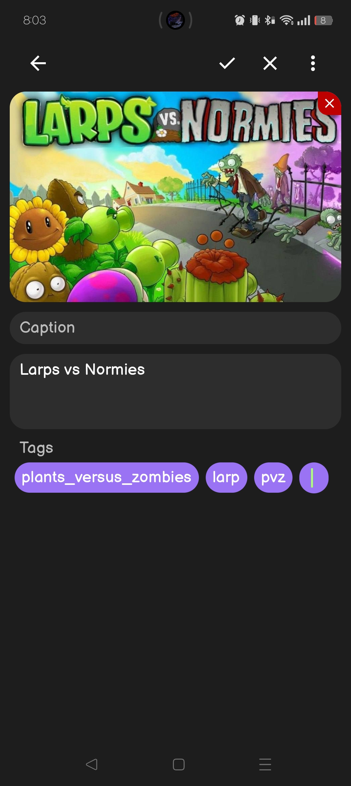
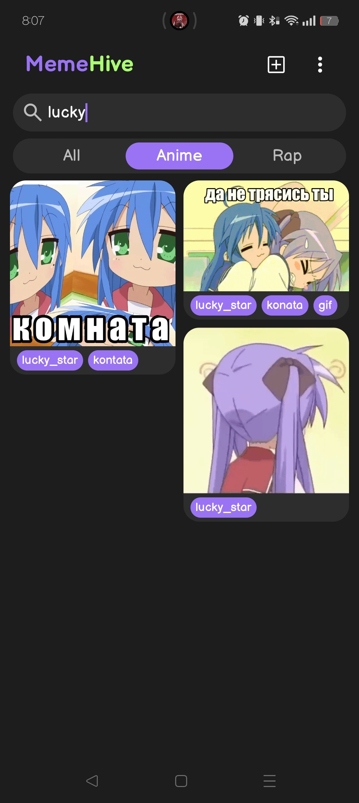
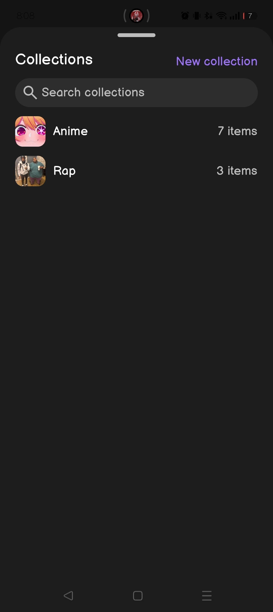
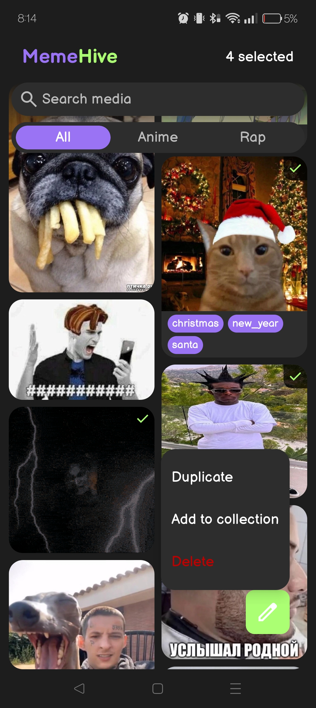
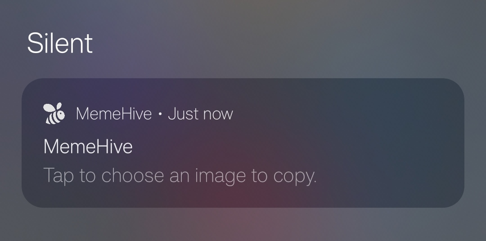
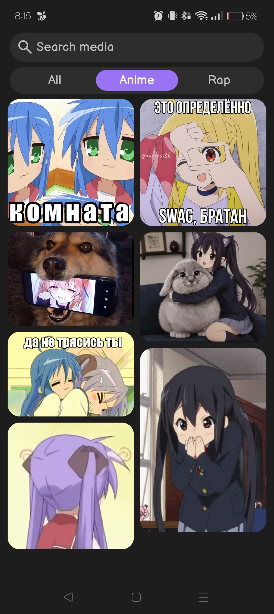

# Using MemeHive

**English** | [Русский](user-guide.ru.md)

[Back to README](../README.md)

MemeHive keeps images and their notes in a searchable library on your Android device. A **media item** contains an optional image, caption, description, and tags. A **collection** groups items; the same item can belong to several collections.

## Add your first meme

1. Tap **+** at the top of the library and choose **New media**.
2. Tap the image area to choose an image.
3. Add a caption and description if useful.
4. In **Tags**, tap **+** and type a tag. Press the keyboard's Done button, type a trailing comma, or move focus away to finish it. Repeat for more tags.
5. Tap the checkmark to save.

Tags are converted to lowercase, and spaces become underscores: `Happy Cat` becomes `happy_cat`. To change a tag, tap its text. Clearing its text removes it when the edit is committed.

### Import several images

Open the library's **⋯ → Import images** menu and select images in the system picker. Each image becomes a media item. If a collection is selected when you start importing, the new items are added to that collection.

You can also share a single image from another app and choose **MemeHive** as the destination. This opens a new item for you to edit and save.

## Browse and search

Tap an item in the library to open it. Use **Search media** to search its tags, caption, or description. Search ignores case; tag matches rank ahead of caption and description matches. Some single-word typing mistakes are also tolerated.

Tap a collection chip to limit results to that collection. Choose **All** to return to the whole library. The collection chooser also lets you search collection names.

## Edit, copy, or duplicate an item

Open an item and edit its fields, then tap the checkmark to save. If you leave with unsaved changes, the app offers to save or discard them.

The item's **⋯** menu includes:

- **Copy image**: copy the saved image to the clipboard, then paste it into an app that accepts pasted images.
- **Add to collection**: change collection membership, then save the item.
- **Set as cover**: choose a collection that should use the saved image as its cover.
- **Duplicate**: create another media item from the saved item.
- **Delete**: delete the media item from the library, including its collection memberships.

Copying and setting a cover require a saved image. Duplicating creates a separate item; add the duplicate to any desired collections afterward.

## Organize collections

1. Tap **+ → New collection**.
2. Enter a name and optionally choose a cover image.
3. Choose **Create**.

To add several existing items, long-press an item in the library to start selection, then tap the other items. Open the floating edit menu and choose **Add to collection**. The same menu offers **Duplicate** and **Delete**. Use the cancel button to leave selection mode.

Long-press a collection chip to open its menu. You can edit its name or cover, export it, or delete it.

Deleting a collection normally keeps its media items in the library. If you enable **Delete collection's contents**, items belonging only to that collection are deleted; items that also belong to another collection are kept. Deleting selected media items directly removes those items from all collections.

## Export and import collections

### Export

1. Long-press a collection chip.
2. Choose **Export**.
3. Choose a destination and save the `.mhc` file.
4. Wait for **Collection exported** before using the file.

The file includes the collection name and cover, its media images, captions, descriptions, and tags. You can keep it outside the app or transfer it to another device.

### Import

1. Open **⋯ → Import collection (.mhc)** in the library.
2. Select a MemeHive `.mhc` file.
3. Wait for **Collection imported**.

Import creates a new collection and new media items. It does not merge them with an existing collection of the same name. Reimporting a file can therefore produce duplicate items, even though identical image contents can share storage internally.

An export contains one collection, not the entire library or the items' memberships in other collections. Items outside the exported collection are not included.

## Use the quick picker

1. Open **⋯ → Enable quick picker** in the library.
2. Allow notifications if Android asks.
3. Open your notifications and tap MemeHive's picker notification.
4. Search or select a collection, then tap an image.
5. The picker copies the image and closes. Paste it into your destination app.

The destination app must support image pasting. The picker is a notification shortcut, not a replacement keyboard. If the notification is missing, enable the quick picker again and check MemeHive's notification settings.

## Storage and backups

Imported images are copied into MemeHive's private storage. The app stores metadata locally and does not provide an account or built-in cloud synchronization. **About** shows storage and cache usage.

Android system backup is enabled in the app, but actual backup and restoration depend on the device and its settings. Collection export is the app's explicit way to save portable copies of collections. Keep important exports outside the app before clearing its data or uninstalling it. Collection exports do not preserve the entire library's organization across collections.

## Troubleshooting

| Problem | What to try |
| --- | --- |
| No search results | Choose **All**, clear the query, or try a shorter word. Search uses saved text, not text detected inside an image. |
| An image cannot be read | Select it again from the file picker and check that the source is still accessible. |
| Copy succeeds but paste is unavailable | Try a destination that supports image clipboard contents. |
| Quick picker cannot be enabled | Allow MemeHive notifications in Android settings, then enable the picker again. |
| Collection import fails | Use an original `.mhc` export. Renaming an unrelated file does not convert it. Check file access and free storage. |
| A large collection will not import | Import limits are 512 MiB total extracted data, 32 MiB per file, 2 MiB for the manifest, and 10,000 archive entries. Split large collections into smaller exports. |
| Image import or duplication reports partial failure | Inspect the library before retrying; earlier items in the batch may already have been created. |
| Library or collections fail to load | Use **Retry** when offered. |
