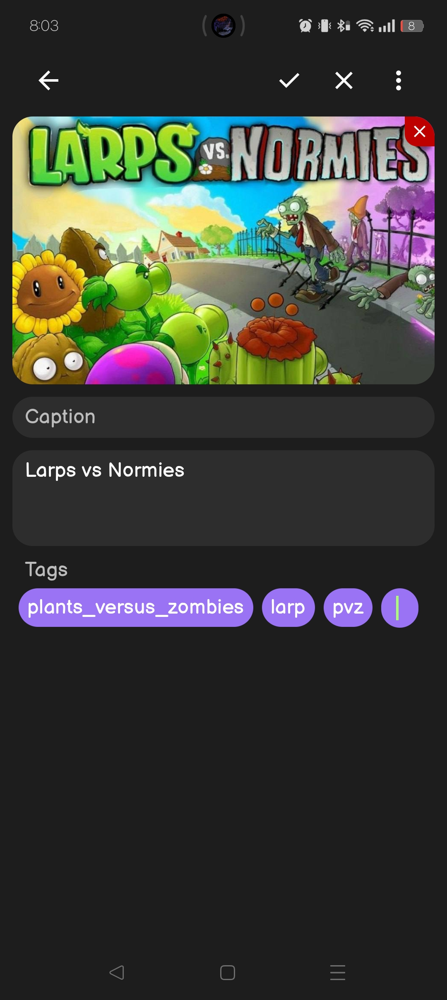
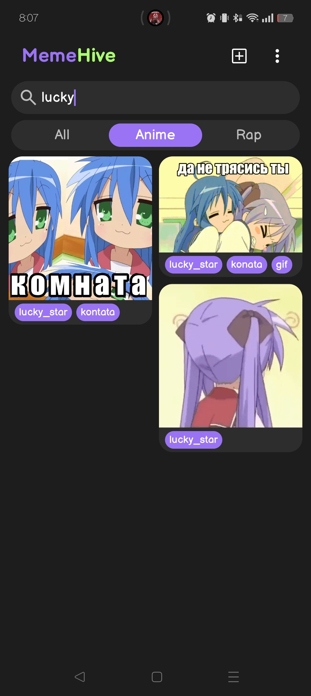
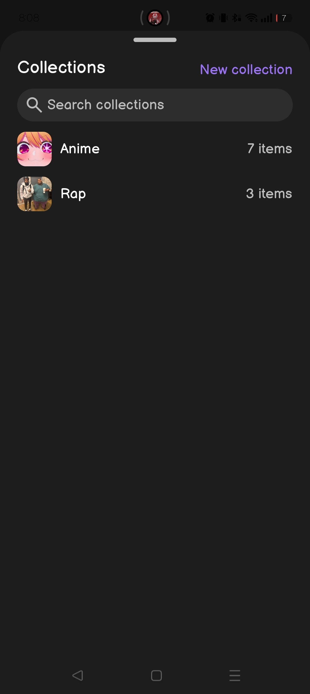
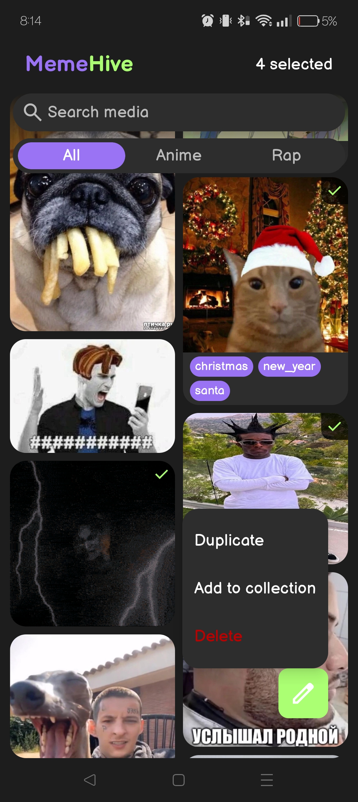
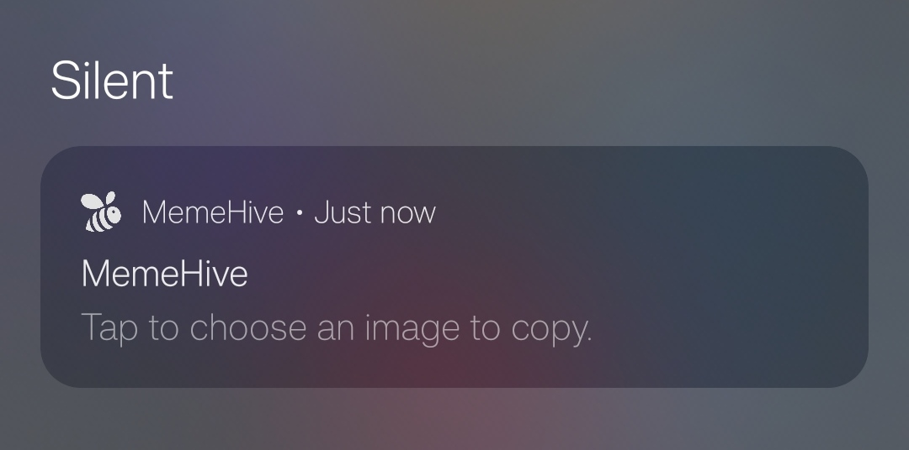
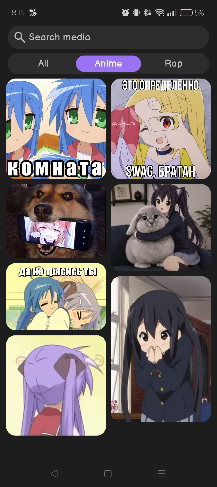

# Использование MemeHive

[English](user-guide.md) | **Русский**

[К README](../README.ru.md)

MemeHive хранит изображения и заметки к ним в библиотеке с поиском на вашем Android-устройстве. **Медиаэлемент** может содержать изображение, подпись, описание и теги. **Коллекция** объединяет элементы; один элемент может входить в несколько коллекций.

На скриншотах показан английский интерфейс. Названия действий в этом руководстве соответствуют русскому интерфейсу приложения.

## Добавление первого мема

1. Нажмите **+** в верхней части библиотеки и выберите **Добавить медиа**.
2. Нажмите на область изображения и выберите файл.
3. При необходимости заполните подпись и описание.
4. В разделе **Теги** нажмите **+** и введите тег. Чтобы завершить ввод, нажмите кнопку готовности на клавиатуре, поставьте запятую в конце или перейдите к другому полю. Повторите для остальных тегов.
5. Нажмите галочку для сохранения.

Теги приводятся к нижнему регистру, а пробелы заменяются подчёркиваниями: `Happy Cat` станет `happy_cat`. Чтобы изменить тег, нажмите на его текст. Если стереть текст и завершить редактирование, тег будет удалён.

### Импорт нескольких изображений

Откройте **⋯ → Импортировать изображения** в библиотеке и выберите изображения в системном окне. Для каждого файла создаётся отдельный медиаэлемент. Если перед импортом выбрана коллекция, новые элементы добавляются в неё.

Также можно отправить одно изображение из другого приложения через меню «Поделиться», выбрав **MemeHive**. Откроется новый элемент, который можно отредактировать и сохранить.

## Просмотр и поиск

Нажмите на элемент библиотеки, чтобы открыть его. Поле **Поиск медиа** ищет по тегам, подписи и описанию. Регистр не учитывается; совпадения в тегах показываются раньше совпадений в подписях и описаниях. Поиск также допускает некоторые опечатки в запросах из одного слова.

Нажмите на название коллекции, чтобы ограничить поиск её содержимым. Выберите **Все**, чтобы вернуться ко всей библиотеке. В окне выбора коллекций доступен поиск по их названиям.

## Редактирование, копирование и дублирование

Откройте элемент, измените поля и нажмите галочку для сохранения. При выходе с несохранёнными изменениями приложение предложит сохранить или отменить их.

В меню **⋯** элемента доступны действия:

- **Скопировать изображение**: скопировать сохранённое изображение в буфер обмена, чтобы вставить его в приложение с поддержкой вставки изображений.
- **Добавить в коллекцию**: изменить принадлежность к коллекциям, затем сохранить элемент.
- **Сделать обложкой**: выбрать коллекцию, для которой сохранённое изображение станет обложкой.
- **Дублировать**: создать новый медиаэлемент на основе сохранённого.
- **Удалить**: удалить элемент из библиотеки и всех его коллекций.

Для копирования и назначения обложки нужно сохранённое изображение. Дубликат — отдельный элемент; при необходимости добавьте его в коллекции после создания.

## Работа с коллекциями

1. Нажмите **+ → Новая коллекция**.
2. Введите название и при желании выберите обложку.
3. Нажмите **Создать**.

Чтобы добавить несколько существующих элементов, удерживайте один из них в библиотеке для перехода в режим выбора, затем отметьте остальные. Откройте плавающее меню редактирования и выберите **Добавить в коллекцию**. Там же доступны **Дублировать** и **Удалить**. Кнопка отмены закрывает режим выбора.

Удерживайте название коллекции, чтобы открыть её меню. В нём можно изменить название или обложку, экспортировать либо удалить коллекцию.

При обычном удалении коллекции её элементы остаются в библиотеке. Если включить **Удалить содержимое коллекции**, будут удалены элементы, принадлежащие только ей; элементы, входящие и в другие коллекции, сохранятся. Прямое удаление выбранных медиаэлементов удаляет их из всех коллекций.

## Экспорт и импорт коллекций

### Экспорт

1. Удерживайте название коллекции.
2. Выберите **Экспорт**.
3. Укажите место сохранения файла `.mhc`.
4. Дождитесь сообщения **Коллекция экспортирована**, прежде чем использовать файл.

Файл включает название и обложку коллекции, изображения её элементов, подписи, описания и теги. Его можно хранить отдельно от приложения или перенести на другое устройство.

### Импорт

1. Откройте **⋯ → Импортировать коллекцию (.mhc)** в библиотеке.
2. Выберите файл коллекции MemeHive с расширением `.mhc`.
3. Дождитесь сообщения **Коллекция импортирована**.

Импорт создаёт новую коллекцию и новые медиаэлементы. Они не объединяются с существующей коллекцией с тем же названием. Повторный импорт может создавать дубликаты элементов, хотя одинаковые изображения могут использовать общий файл в хранилище.

Экспорт содержит одну коллекцию, а не всю библиотеку или сведения о принадлежности элементов к другим коллекциям. Элементы вне экспортируемой коллекции в файл не попадают.

## Быстрый выбор

1. Откройте **⋯ → Включить быстрый выбор** в библиотеке.
2. Разрешите уведомления, если Android запросит доступ.
3. Откройте панель уведомлений и нажмите на уведомление MemeHive.
4. Найдите изображение через поиск или выберите коллекцию, затем нажмите на изображение.
5. Окно быстрого выбора скопирует изображение и закроется. Вставьте его в нужное приложение.

Приложение-получатель должно поддерживать вставку изображений. Быстрый выбор открывается из уведомления и не заменяет клавиатуру. Если уведомление пропало, включите быстрый выбор снова и проверьте настройки уведомлений MemeHive.

## Хранение и резервные копии

Импортированные изображения копируются в закрытое хранилище MemeHive. Метаданные также хранятся локально; в приложении нет учётных записей или встроенной облачной синхронизации. В разделе **О приложении** отображается объём хранилища и кэша.

Системное резервное копирование Android включено, но его работа и восстановление зависят от устройства и настроек. Экспорт позволяет самостоятельно сохранить переносимые копии коллекций. Перед очисткой данных или удалением приложения сохраните важные коллекции вне его хранилища. Экспорт коллекций не сохраняет всю структуру связей между коллекциями и элементами библиотеки.

## Решение проблем

| Проблема | Что попробовать |
| --- | --- |
| Поиск ничего не находит | Выберите **Все**, очистите запрос или сократите его. Поиск использует сохранённый текст, а не распознаёт надписи на изображениях. |
| Изображение не читается | Выберите его заново и убедитесь, что исходный файл доступен. |
| Копирование работает, а вставка недоступна | Попробуйте приложение с поддержкой изображений в буфере обмена. |
| Не удаётся включить быстрый выбор | Разрешите уведомления MemeHive в настройках Android и включите быстрый выбор снова. |
| Ошибка импорта коллекции | Используйте исходный экспорт `.mhc`. Переименование другого файла не превращает его в коллекцию. Проверьте доступ к файлу и свободное место. |
| Большая коллекция не импортируется | Ограничения: 512 МиБ распакованных данных суммарно, 32 МиБ на файл, 2 МиБ на манифест и 10 000 записей в архиве. Разделите коллекцию на несколько меньших. |
| Импорт изображений или дублирование завершились частично | Перед повторной попыткой проверьте библиотеку: часть элементов уже могла быть создана. |
| Библиотека или коллекции не загружаются | Нажмите **Повторить**, если эта кнопка доступна. |
